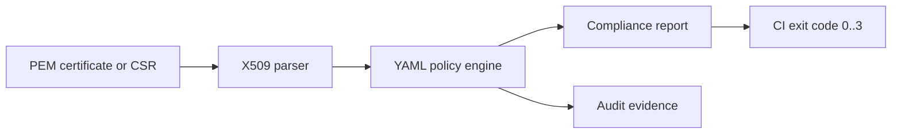

# Neakam

[](https://github.com/thulisa-n/pki-compliance-gate/actions/workflows/compliance.yml)
[](https://github.com/thulisa-n/pki-compliance-gate/actions/workflows/security-scans.yml)


**Neakam** (PKI Compliance Gate) evaluates an X.509 certificate (or CSR)
against a YAML policy and returns a CI exit code plus evidence. It is not a
linter and not a full path validator. Use [zlint](https://github.com/zmap/zlint) for
RFC/BR encoding lint, `openssl verify` for chain and revocation, and this gate
for *this profile in this pipeline*. See [docs/COMPARE.md](docs/COMPARE.md).

Neakam collects no telemetry. The only network use is a live TLS check you opt
into with `--allow-network`. See [NO_TELEMETRY.md](NO_TELEMETRY.md).

The command is `neakam`. `pki-gate` and `certguard` still run, and each prints
a one-line deprecation notice. The Python import package remains `certguard`.
The PyPI project name remains `pki-compliance-gate` (renaming it is a
follow-up). This repository's GitHub name is unchanged.

One YAML profile is the source of truth for evaluation, CI gating, and
generated CP/CPS Section 7 documentation.

---

## Evaluate a certificate

Pin an immutable release tag (there is no moving `v1` tag). `v0.2.6` is the
current source version.

> **Upgrading from 0.1.x is a breaking change.** Expiry and EC key policy are
> now enforced by default, and the report no longer carries a `score` field.
> See [`CHANGELOG.md`](CHANGELOG.md).

**GitHub Action**

```yaml
steps:
  - uses: actions/checkout@v4
  - name: Run PKI Compliance Gate
    uses: thulisa-n/pki-compliance-gate@v0.2.6
    with:
      cert: path/to/server.crt
      as-of: '2026-09-18'
```

**PyPI**

```bash
python3 -m pip install "pki-compliance-gate==0.2.6"
neakam --cert path/to/server.crt --as-of 2026-09-18
```

**Expected reject (not a bug):** this expired fixture used to exit 0, which was
a false negative. It now correctly exits **3** (critical: `certificate_not_expired`).

```bash
neakam --cert tests/certificates/expired_cert.pem --as-of 2026-09-18
```

Expected outcomes for every committed PEM live in
[`corpus/verdicts.yaml`](corpus/verdicts.yaml). Same PEM + same policy + same
`--as-of` yields the same `verdict_digest` (see
[`src/certguard/data/compliance-report-2.0.schema.json`](src/certguard/data/compliance-report-2.0.schema.json)).

### Pre-issuance (CSR)

`--csr` checks only what exists before the CA signs (key, SAN, internal names,
PoP signature). Validity, serial, SCT, and path profile are `not_applicable`,
not guessed. Copy-paste examples: [`examples/pre-issuance/`](examples/pre-issuance/).

**Expected reject (not a bug):** this CSR is RSA 1024. The gate must exit **3**
(`rsa_key_size`). Use `tests/certificates/csrs/valid.csr` for an exit 0 demo.

```bash
neakam --csr tests/certificates/csrs/weak_key.csr
```

---

## What the default profile enforces

`policies/cabf_policy.yaml`:

- **Validity**: maximum 200 days; certificate must be inside its notBefore/notAfter window.
- **Key material**: RSA >= 2048; ECDSA >= 256 bits on P-256/P-384/P-521 only; RSA and EC are the only permitted algorithms.
- **Signature**: no SHA-1 or MD5; AlgorithmIdentifier allowlist on.
- **Identity**: SAN required; internal DNS suffixes blocked (`.local`, `.internal`, `.intranet`); serial entropy on.
- **Trust scope**: `public` (`trust.scope`). CA/B Forum controls that apply only to publicly-trusted TLS are assessed. `private` and `auto` report those controls as `not_applicable`. See [Trust scope](#trust-scope).
- **Optional overlays** (off by default): DCV attestation, RFC 5280 extension and path profile, HSM/FIPS issuance attestation, crypto-transition targets, SCT presence, EKU profile, OPA/Rego gate, zlint and `openssl asn1parse`.
- **API TLS posture** (`--mode apisec --allow-network --endpoint https://example.com`): live TLS version, weak-cipher, expiry and certificate checks. Off unless `--allow-network` is set. The check contacts only that host, times out, and does not follow redirects.

### Coverage matrix

Every control the engine can emit. A control the active profile does not enable
is reported as `not_applicable` -- defined but **not assessed** -- and is never
counted as a pass.

| Control | Rule ID | Category | Severity | Standard reference |
| :--- | :--- | :--- | :--- | :--- |
| `certificate_expiry_window` | OPS-RENEWAL-WINDOW | VALIDITY | low | Operational renewal policy |
| `certificate_not_expired` | RFC-5280-4.1.2.5 | VALIDITY | critical | RFC 5280 4.1.2.5 / CA/B Forum BR 6.3.2 |
| `certificate_not_yet_valid` | RFC-5280-4.1.2.5 | VALIDITY | high | RFC 5280 4.1.2.5 |
| `crypto_transition_rsa_target` | CRYPTO-AGILITY-RSA | CRYPTO-TRANSITION | medium | Crypto transition readiness profile |
| `crypto_transition_signature_hash` | CRYPTO-AGILITY-HASH | CRYPTO-TRANSITION | high | Crypto transition readiness profile |
| `crypto_transition_validity_target` | CRYPTO-AGILITY-VALIDITY | CRYPTO-TRANSITION | high | Crypto transition readiness profile |
| `dcv_method` | CAB-BR-3.2.2.4 | DCV | high | CA/B Forum BR 3.2.2.4 |
| `dcv_recency` | CAB-BR-4.2.1 | DCV | high | CA/B Forum BR 4.2.1 |
| `ec_curve_allowed` | CAB-BR-6.1.5 | CRYPTOGRAPHY | critical | CA/B Forum BR 6.1.5 |
| `ec_key_size` | CAB-BR-6.1.5 | CRYPTOGRAPHY | critical | CA/B Forum BR 6.1.5 |
| `internal_domain_check` | CAB-BR-7.1.4.2.1 | POLICY | high | CA/B Forum BR 7.1.4.2.1 |
| `issuance_fips_level` | FIPS-140-CONTROL | ISSUANCE | medium | FIPS 140-2/140-3 |
| `issuance_hsm_attestation` | PKCS11-HSM-ATTESTATION | ISSUANCE | high | PKCS#11 / FIPS operations |
| `key_algorithm_allowed` | CAB-BR-6.1.5 | CRYPTOGRAPHY | critical | CA/B Forum BR 6.1.5 |
| `rfc5280_authority_key_identifier` | RFC-5280-4.2.1.1 | RFC5280 | medium | RFC 5280 4.2.1.1 |
| `rfc5280_critical_extension_profile` | RFC-5280-4.2 | RFC5280 | high | RFC 5280 4.2 |
| `rfc5280_end_entity_ca` | RFC-5280-4.2.1.9 | RFC5280 | high | RFC 5280 4.2.1.9 |
| `rfc5280_key_usage_profile` | RFC-5280-4.2.1.3 | RFC5280 | high | RFC 5280 4.2.1.3 |
| `rfc5280_path_aki_ski_match` | RFC-5280-4.2.1.1 | RFC5280 | medium | RFC 5280 4.2.1.1 |
| `rfc5280_path_issuer_subject_match` | RFC-5280-6 | RFC5280 | high | RFC 5280 6.1 |
| `rfc5280_subject_key_identifier` | RFC-5280-4.2.1.2 | RFC5280 | medium | RFC 5280 4.2.1.2 |
| `rsa_key_size` | CAB-BR-6.1.5 | CRYPTOGRAPHY | critical | CA/B Forum BR 6.1.5 |
| `san_extension` | RFC-5280-4.2.1.6 | IDENTITY | high | CA/B Forum BR 7.1.4.2.1 |
| `signature_algorithm` | CAB-BR-7.1.3 | CRYPTOGRAPHY | critical | CA/B Forum BR 7.1.3 |
| `validity_days` | CAB-BR-6.3.2 | VALIDITY | high | CA/B Forum BR 6.3.2 |

### Not covered yet

Stated plainly so the matrix above is not mistaken for full BR conformance.
None of the following are implemented: revocation checking (CRL/OCSP), OCSP
must-staple, full RFC 5280 path validation, CN-in-SAN consistency,
wildcard placement rules, and reserved or internal **IP addresses** in SANs
(only DNS suffixes are checked). SCT presence, EKU profiles, and serial-number
entropy exist as policy controls; SCT and EKU stay **off** on the default
profile. Trust scope `auto` walks a supplied chain to one self-signed CA root.
It does not fetch certificates and it does not check revocation.

## Trust scope

The gate supports three trust scopes for CA/B Forum controls that apply only
to publicly-trusted TLS. The default is `public`, so a run that sets neither
the flag nor the policy key keeps the current results.

| Input | Values |
| :--- | :--- |
| CLI | `--trust-scope {public,private,auto}` |
| Policy | `trust.scope` (same three values) |

An explicit `--trust-scope` overrides `trust.scope`. When the flag is omitted
and the policy key is omitted, the scope is `public` (`source: default`).

| Scope | What the engine does |
| :--- | :--- |
| `public` | Assesses the public-TLS controls. |
| `private` | Reports those controls as `not_applicable`. The control detail is `CA/B Forum Baseline Requirements apply to publicly-trusted TLS; trust scope is private`. |
| `auto` | `private` only when `--chain` verifies offline to a single self-signed CA root and that root's SPKI SHA-256 is **not** in the public-trust root set. Otherwise `public`, and the report states why. |

The public-trust root set is `--public-trust-roots`, or `trust.public_roots`
when the flag is omitted. It is a file or a directory of PEM or DER root
certificates, or of SPKI SHA-256 hashes (`hex`, `sha256:<hex>`, or
`sha256/<base64>`). An explicit `--public-trust-roots` overrides the policy
path. The gate reads only that local path. It does not fetch roots,
certificates, or revocation data.

`auto` stays `public` when any of these is true: no chain, no root set, an
empty or unreadable root set, a chain that does not verify, more than one
issuer candidate, a loop, an issuer that is not a CA, an issuer or root
outside its validity window, or a CSR.

Public-TLS-only controls:

- `validity_days` (BR 6.3.2 maximum validity)
- `internal_domain_check` (BR 7.1.4.2.1 internal names)
- `serial_entropy` (BR 7.1 serial entropy)
- `sct_presence` (Certificate Transparency)
- `dcv_method` and `dcv_recency` (BR 3.2.2.4 and 4.2.1)
- the optional OPA validity gate, which repeats `certificate.max_validity_days`

These stay in force for every trust scope: expiry and renewal window, SAN,
EKU, key size, curves, signature algorithms (including the OID allowlist),
RFC 5280 structure, issuance attestation, and the crypto-transition overlay.
zlint and `openssl asn1parse`, when the policy enables them, are unchanged.

JSON (`trust_scope`), text output, the reviewer summary, the job summary, and
SARIF run properties (`trustScope`) record `requested`, `effective`, `source`,
and `reason`. The verdict digest includes that decision and omits filesystem
paths.

### Evidence and integrity

Each run writes a compliance report, per-control evidence, and an
`evidence_manifest.json` that records a **SHA-256 digest of every evidence
file**, the engine version, and the digest of the policy bytes that produced
the verdict. The report also carries `verdict_digest`: SHA-256 of the canonical
decision (not the file path). Digests are **not signatures**. Tamper-evident
custody comes from the cosign keyless signature produced in this repository's
CI on `push` to `main`.

### Exit codes

- `0`: no failing checks (and lint not failed)
- `1`: only low-severity check failures
- `2`: medium/high failures, lint failure, or CLI usage/input errors
- `3`: at least one critical check failure

`--fail-on-waived` counts waived findings as failures, for audit runs where an
approved exception must still block.

### Reports carry no percentage score

A single percentage was removed in report schema 2.0. It counted controls the
policy had never enabled, so an almost-empty profile read 100%, and a
certificate failing a *critical* control could still present as ~95%. Reports
now carry `findings` bucketed by severity and a `coverage` block stating how
much was actually assessed:

```text
Compliant: NO
Risk Level: HIGH
Findings: critical=2
Coverage: 12 of 29 controls evaluated (10 pass, 2 fail, 0 waived, 17 not applicable)
```

## How it flows



---

## Self-test

`neakam doctor` checks that this install can run offline:

- Python is 3.11 or newer
- the package and bundled policy files load
- bundled policies parse with `yaml.safe_load`
- a bundled fixture certificate evaluates

It does not use the network.

- `0`: every check passed
- `1`: a check failed
- `2`: usage error

`neakam doctor --json` prints the same result as JSON. `--debug` adds a
traceback. Doctor output does not include key or licence material.

## Advanced modes

The product is `neakam --cert`. `neakam --help` lists the same split as
below: first-class modes make a decision, derived helpers only render one.

### First-class modes

| Mode | Example | What the code does |
| :--- | :--- | :--- |
| `evaluate` | `neakam --cert server.crt` | Full policy evaluation of a certificate or CSR. |
| `triage` | `neakam --mode triage --report-input report.json` | Turns report findings into severity-ranked next actions. |
| `assure` | `neakam --mode assure --report-input report.json` | Independently recomputes whether the report's `compliant` flag matches checks and lint. |
| `watch` | `neakam --mode watch` | Diffs the loaded policy against `policies/standards_baseline.yaml`. |
| `heal` | `neakam --mode heal --healed-cert new_cert.pem` | Writes a remediation plan; re-evaluates only if `--healed-cert` is provided. |
| `apisec` | `neakam --mode apisec --allow-network --endpoint https://example.com` | Opt-in live TLS posture check of the host you list. |
| `signals` | `neakam --mode signals` | Reads curated external signals JSON and writes recommendations. |
| `readiness` | `neakam --mode readiness --as-of 2027-03-15` | Assesses the loaded policy against the dated CA/B validity schedule. |

### Derived helpers

These render an existing report or the policy YAML. They do not issue a verdict.

| Mode | Example | What the code does |
| :--- | :--- | :--- |
| `summary` | `neakam --mode summary --report-input report.json` | Writes a reviewer Markdown summary. |
| `trend` | `neakam --mode trend --report-input report.json` | Writes a trend snapshot JSON. |
| `export-cps-doc` | `neakam --mode export-cps-doc` | Renders the YAML policy as CP/CPS Section 7 Markdown. |
| `export-rego` | `neakam --mode export-rego` | Emits an OPA/Rego validity gate from `certificate.max_validity_days`. |

## Repository structure

```text
src/certguard/          Implementation package (import name unchanged this release)
src/neakam/             Import shim for the product name
policies/               Policy YAML profiles; optional generated Rego
corpus/                 Published expected verdicts for committed fixtures
examples/pre-issuance/  CSR / cert-manager / step-ca wiring
tests/                  Automated test suite
action.yml              Composite GitHub Action
```

---

## Distribution status

The GitHub Action, wheel, and sdist are published from the `v0.2.6` tag.
Install the CLI with `pip install pki-compliance-gate==0.2.6`, then run
`neakam`. The PyPI distribution name is still `pki-compliance-gate`; renaming
that project, and applying the same product-name change in the private
enterprise repository, are follow-ups. Later GitHub releases reuse
`.github/workflows/publish.yml` with PyPI trusted publishing (OIDC, no API
token in the repository).

A commercially licensed add-on is maintained privately and is not part of
this repository.

---

## Security

Report vulnerabilities privately: see [SECURITY.md](SECURITY.md). False-positive
findings belong in a GitHub issue using the false-positive template.

## License

Licensed under the [Apache License 2.0](LICENSE).
